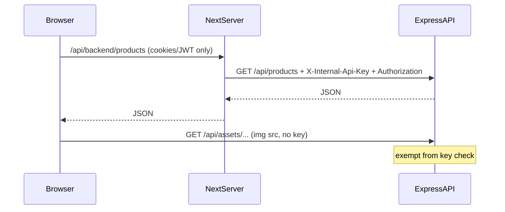

# Internal API Key Gate (Option #2)

> **Status:** paused — implement later  
> **Saved:** 2026-07-22  
> **Do not start until product owner resumes this work.**

---

## Overview

Add backend middleware that requires `X-Internal-Api-Key` matching `INTERNAL_API_KEY` on protected API routes (with browser-safe exemptions), update E2E/Postman, and rewrite `inbetween.md` so frontend implements a Next.js server proxy under option #2 (server-only key, not `NEXT_PUBLIC`).

## Todos (when resumed)

1. Add `internalApiKey` middleware with timing-safe compare + exempt paths; mount in `app.js`; require env
2. Wire key into E2E + Postman generator; update `api-endpoints.md` and `backendagent.md`; run `test:e2e`
3. Rewrite `inbetween.md` with done status + option #2 frontend proxy instructions (no `NEXT_PUBLIC` key)

---

## Recommendation

**Prefer option #2** (server-only key + Next.js proxy). That keeps the secret out of the browser bundle.

**Do not use `NEXT_PUBLIC_INTERNAL_API_KEY` for this design.** The `NEXT_PUBLIC_` prefix ships the value to every client. Use server-only:

```env
# frontend/.env (server-only — no NEXT_PUBLIC_)
INTERNAL_API_KEY=<same value as backend>
```

Backend continues to use `INTERNAL_API_KEY` (already in `backend/src/config/env.js` as `env.internalApiKey`).



---

## Backend work

### 1. Require env

In `backend/src/config/env.js`:

- Keep `internalApiKey: process.env.INTERNAL_API_KEY`
- Fail startup if `INTERNAL_API_KEY` is missing/empty (dev + production)
- Do **not** commit real key values; update `.env.example` with a placeholder only

### 2. New middleware

Create `backend/src/middleware/internalApiKey.middleware.js`:

- Header: `X-Internal-Api-Key`
- Compare with `crypto.timingSafeEqual`
- Missing/mismatch → `401` `{ success: false, message: "Invalid or missing internal API key." }`

**Exempt paths** (browser hits without custom headers):

| Path | Why |
|------|-----|
| `GET /` | Ops ping |
| `/api/health` (+ subpaths) | Health checks |
| `/api/assets` (+ subpaths) | `` / static product images |
| `GET /api/auth/google/start` | Browser redirect into Google |
| `GET /api/auth/google/callback` | Browser redirect back from Google |

All other `/api/*` routes require the key **in addition to** existing JWT/admin middleware where applicable.

### 3. Mount early in `backend/src/app.js`

After `cors` / `express.json`, before route mounts:

```js
app.use(internalApiKeyMiddleware);
```

### 4. Tooling / tests

| File | Change |
|------|--------|
| `backend/scripts/e2e-full-scenario.js` | Send `X-Internal-Api-Key` on non-exempt requests; assert missing key → `401` |
| `backend/scripts/generate-postman-collection.js` | Variable `internalApiKey`; default header |
| `npm run postman:generate` | Refresh Postman JSON |
| `baseDocs/api-endpoints.md` | Global note: most routes need `X-Internal-Api-Key` |
| `backend/backendagent.md` | Architecture decision |

Run `npm run test:e2e` before marking done.

### 5. Update `inbetween.md` (frontend handoff)

When implementation is complete, document:

**Backend done — Internal API key (option #2)**

- Header: `X-Internal-Api-Key: <INTERNAL_API_KEY>`
- Required on all `/api/*` except health, assets, Google start/callback
- JWT still required on protected routes as before

**Frontend must do:**

1. Env: server-only `INTERNAL_API_KEY` (same as backend). Remove `NEXT_PUBLIC_INTERNAL_API_KEY` if present.
2. Do **not** send the key from browser `apiRequest` / client components.
3. Add Next.js BFF proxy e.g. `app/api/backend/[...path]/route.ts` that injects `X-Internal-Api-Key` and forwards `Authorization`.
4. Point API client at same-origin proxy base (e.g. `/api/backend`).
5. Keep asset URLs on backend `/api/assets/...` (exempt) or proxy images through Next.
6. Google OAuth: browser still hits backend start/callback (exempt).
7. Update Playwright/E2E accordingly.
8. Update `frontend/.env.example` with `INTERNAL_API_KEY=` (no `NEXT_PUBLIC_`).

---

## Out of scope (for the paused backend task)

- Implementing the Next.js proxy in the backend session (frontend team after backend ships)
- Putting the key in the browser bundle
- Replacing JWT with the internal key
- DB / seed changes
